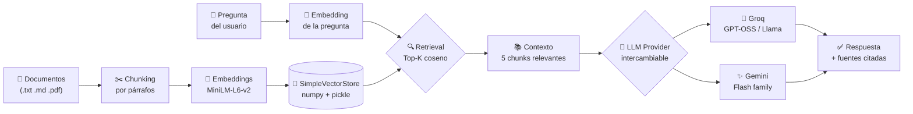
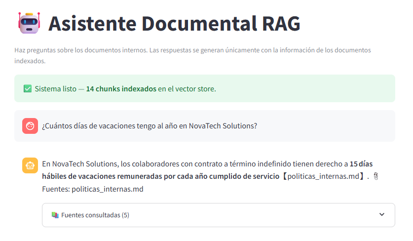
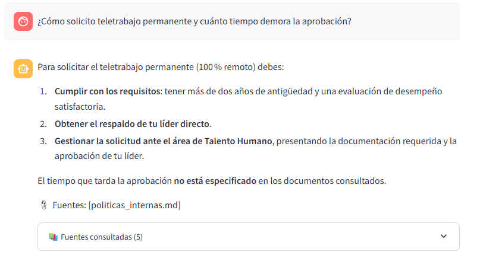
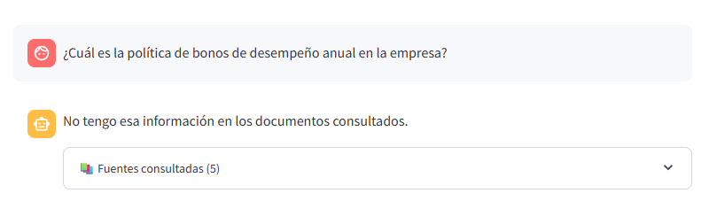
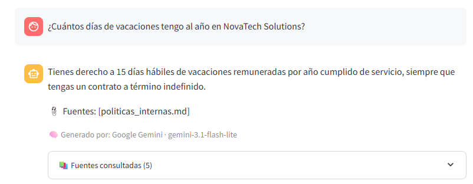

# 🤖 Asistente Documental RAG

> **Prueba técnica — AI Developer Engineer Junior**
> **Cliente:** I Cloud Seven · **Candidato:** Juan Sebastian Galeano Guerrero
> **Fecha:** Noviembre 2026

Asistente conversacional que permite consultar documentos internos mediante un pipeline **Retrieval-Augmented Generation (RAG)** con soporte **multi-provider LLM** (Groq + Google Gemini intercambiables desde la UI). Responde únicamente con la información de los documentos indexados y cita las fuentes consultadas.

---

## 🎥 Video demo (19 s)

Demostración rápida del sistema: chat, como se ve la pagina principal.


https://github.com/user-attachments/assets/1be19311-5cdf-46d4-a3bf-8c14dc0a4829


👉 **[Ver `demo_ui.mp4`](./evidencias/demo_ui.mp4)** — descarga directa (54 MB)

> Nota: el video pesa más del límite de preview inline de GitHub, por lo que se abre al hacer clic. Para ejecución local, ver [Instalación y ejecución](#instalación-y-ejecución).

---

## 📋 Tabla de contenidos

- [Descripción](#descripción)
- [Arquitectura](#arquitectura)
- [Stack técnico](#stack-técnico)
- [Estructura del proyecto](#estructura-del-proyecto)
- [Instalación y ejecución](#instalación-y-ejecución)
- [Multi-provider LLM](#multi-provider-llm)
- [Despliegue en la nube](#despliegue-en-la-nube)
- [Pruebas realizadas](#pruebas-realizadas)
- [Uso de AI-assisted development](#uso-de-ai-assisted-development)
- [Limitaciones y mejoras futuras](#limitaciones-y-mejoras-futuras)
- [Sobre el candidato](#sobre-el-candidato)

---

## Descripción

Pipeline RAG clásico de 6 etapas:

1. **Carga** de documentos (`.txt`, `.md`, `.pdf`)
2. **Chunking** respetando párrafos (1.000 caracteres por chunk)
3. **Embeddings** locales con `sentence-transformers/all-MiniLM-L6-v2`
4. **Indexación** en `SimpleVectorStore` (basado en numpy + pickle, similitud coseno)
5. **Recuperación** top-5 chunks más relevantes
6. **Generación** con Groq (Llama/GPT-OSS) o Google Gemini — intercambiables desde la UI

Cada respuesta incluye las fuentes consultadas con nombre de archivo, chunk, score de relevancia y el modelo que generó la respuesta.

---

## Arquitectura



**Decisiones de diseño clave:**

- **Multi-provider** con interfaz común `LLMProvider` → el usuario alterna entre Groq y Gemini sin cambiar código.
- **Embeddings locales** → cero costo recurrente, cero latencia de red para esta parte.
- **SimpleVectorStore con numpy** en vez de ChromaDB/FAISS → para < 10k chunks es más eficiente, portable y evita dependencias con compilación nativa en Windows.
- **Prompt engineering estricto** → el modelo declara "no tengo esa información" cuando el contexto no la tiene, en vez de alucinar.

---

## Stack técnico

| Componente | Tecnología | Nota |
|---|---|---|
| Lenguaje | Python 3.11 | Estándar en Data/AI |
| UI | Streamlit 1.40 | Chat out-of-the-box, deploy rápido |
| LLM A | Groq (`openai/gpt-oss-120b`) | Latencia sub-segundo, tier gratis |
| LLM B | Google Gemini (`gemini-flash-latest`) | Alias auto-actualizable, tier gratis |
| Embeddings | sentence-transformers (MiniLM-L6-v2) | Local, gratis, 90 MB |
| Vector store | SimpleVectorStore (numpy + pickle) | Zero deps nativas, portable |
| PDF | pypdf | Extracción de texto confiable |
| Config | python-dotenv | Secrets fuera del código |

---

## Estructura del proyecto

```
rag-assistant-ic7/
├── src/                       # Código fuente
│   ├── app.py                 # UI Streamlit
│   ├── rag.py                 # Pipeline RAG + SimpleVectorStore
│   ├── loader.py              # Carga + chunking de documentos
│   ├── config.py              # Configuración vía .env
│   └── llm_providers.py       # Abstracción de proveedores LLM
├── docs/                      # Documentación complementaria
│   ├── AI_USAGE.md
│   └── PRUEBAS.md
├── documentos/                # Documentos a indexar
├── evidencias/                # Capturas + video demo
├── .env.example               # Template de variables
├── Dockerfile                 # Imagen lista para cloud
├── requirements.txt
└── README.md
```

---

## Instalación y ejecución

### Requisitos
- Python 3.10+
- Git
- Al menos una API key: [Groq](https://console.groq.com/keys) o [Google Gemini](https://aistudio.google.com/apikey) (ambos gratis)

### Pasos

```bash
# 1. Clonar
git clone https://github.com/juanseDev31/rag-assistant-ic7.git
cd rag-assistant-ic7

# 2. Entorno virtual
python -m venv venv
venv\Scripts\activate         # Windows
# source venv/bin/activate    # Linux/Mac

# 3. Instalar dependencias
pip install -r requirements.txt

# 4. Configurar secretos
copy .env.example .env        # Windows
# cp .env.example .env        # Linux/Mac
# ⚠️ Editar .env con tus API keys

# 5. Correr la app
streamlit run src/app.py
```

La app se abre en `http://localhost:8501`. Primer arranque: ~1 min (descarga modelo de embeddings).

**Para cargar documentos propios:** arrastra tus `.txt`, `.md` o `.pdf` al área del sidebar y clic en **🔄 Re-indexar**.

---

## Multi-provider LLM

Desde el sidebar puedes alternar entre Groq y Gemini en tiempo real. El pipeline de retrieval es el mismo; solo cambia quién genera la respuesta final.

| Provider | Fortaleza | Modelo probado |
|---|---|---|
| 🚀 **Groq** | Latencia extremadamente baja (~1 s) | `openai/gpt-oss-120b` |
| ✨ **Google Gemini** | Respuestas más estructuradas | `gemini-flash-latest` |

**Para agregar un tercer proveedor:** implementar la clase `LLMProvider` en `src/llm_providers.py` y registrarla en `build_provider()`.

---

## Despliegue en la nube

El proyecto está containerizado y es compatible con cualquier plataforma de contenedores (AWS App Runner, Azure Container Apps, Google Cloud Run, IBM Cloud Code Engine, ECS Fargate).

**Despliegue en Streamlit Community Cloud:**

1. Push del repo a GitHub.
2. [share.streamlit.io](https://share.streamlit.io) → New app → seleccionar repo.
3. Archivo principal: `src/app.py`.
4. En **Secrets**, agregar:
   ```toml
   GROQ_API_KEY = "gsk_..."
   GOOGLE_API_KEY = "AIza..."
   ```
5. Deploy.

---

## Pruebas realizadas

Las 3 preguntas requeridas por el enunciado (respuesta completa / parcial / fuera de alcance) se validaron con éxito. Ver el detalle completo con respuestas reales y análisis en [`docs/PRUEBAS.md`](./docs/PRUEBAS.md).

**Vista rápida de evidencias:**

| Prueba | Captura |
|---|---|
| ✅ Respuesta completa — "¿Cuántos días de vacaciones tengo?" |  |
| 🟡 Respuesta parcial — "¿Teletrabajo + tiempo de aprobación?" |  |
| ❌ Fuera de alcance — "¿Política de bonos?" |  |
| ✨ Multi-provider — misma pregunta con Gemini |  |

Todas las capturas y un video demo de la UI (`demo_ui.mp4`) están en la carpeta [`evidencias/`](./evidencias/).

---

## Uso de AI-assisted development

Ver [`docs/AI_USAGE.md`](./docs/AI_USAGE.md) con el detalle transparente de las herramientas usadas, qué se delegó, qué se revisó manualmente y aprendizajes extraídos.

---

## Limitaciones y mejoras futuras

**Limitaciones actuales:**
- Sin memoria conversacional multi-turno
- Sin re-ranking de chunks (se usan directamente los top-K del vector store)
- Sin umbral de relevancia (siempre devuelve K fuentes aunque sean poco relevantes)
- Sin autenticación de usuarios
- Sin tests automatizados

**Próximas iteraciones priorizadas:**
- Agregar re-ranking con Cohere Rerank para mejorar precisión del contexto
- Integrar **IBM watsonx** como tercer provider (alineación con stack IBM del candidato)
- Métricas comparativas por provider (latencia, costo, calidad) directamente en la UI
- Autenticación SSO (SAML 2.0 / OIDC)
- Tests unitarios + CI/CD con GitHub Actions
- Despliegue productivo en AWS App Runner o Azure Container Apps

---

## Sobre el candidato

**Juan Sebastian Galeano Guerrero** — Technical BDR en **TD SYNNEX**, enfocado en **IBM Cloud + Data & AI**.

### Certificaciones

**☁️ AWS**
- AWS Certified Solutions Architect – Associate
- AWS Certified AI Practitioner
- AWS Certified Cloud Practitioner

- **☁️ MICROSOFT**
- AZ-900: Microsoft Azure Fundamentals

**🔵 IBM Cloud**
- IBM Certified Professional Architect v6 PLUS IBM Professional Cloud Developer v6
- IBM Certified Professional Architect v6 PLUS IBM Professional Cloud SRE v2
- IBM Certified Professional Architect - Cloud v6

### Formación
- **Ingeniería de Sistemas** — Politécnico Grancolombiano (2026)
- **Tecnólogo en Desarrollo de Software**

### Experiencia relevante
- T[ecnico/comercial cloud en TD SYNNEX (IBM Cloud + Data & AI)
- Demos técnicas con IBM Cloud (Object Storage, MQaaS, Schematics)
- Capacitaciones a Business Partners en Kubernetes, Red Hat OpenShift (ROKS)
- POCs con watsonx (Orchestrate) para clientes

### Objetivo profesional
Transición hacia roles técnicos cloud: **Cloud Engineer** / **DevOps Engineer** / **AI Engineer**, con enfoque en implementación práctica de soluciones AI y cloud-native.

### Contacto
📧 **juansegaleanog@gmail.com**
💻 **GitHub:** [juanseDev31](https://github.com/juanseDev31)
💼 **LinkedIn:** [Juan Sebastian Galeano](https://www.linkedin.com/in/)
