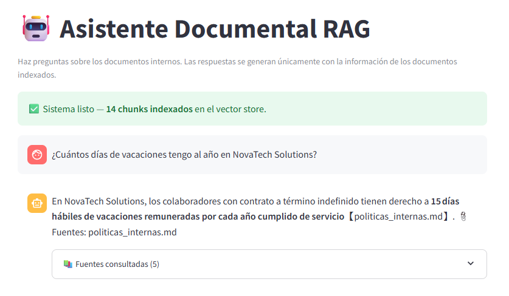
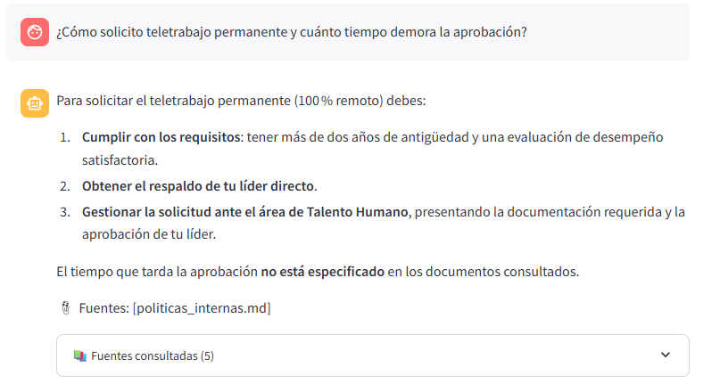
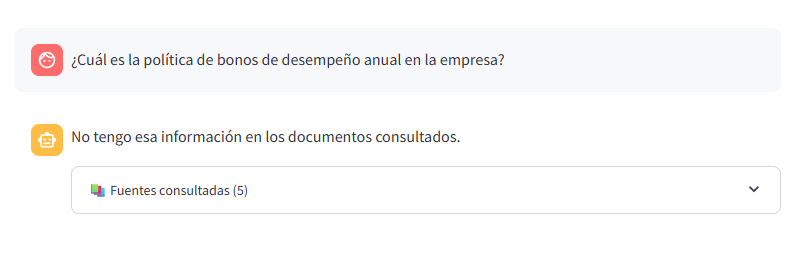
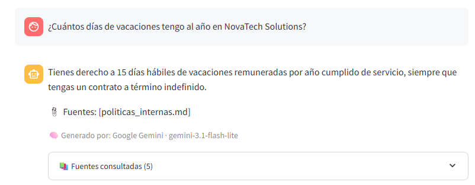
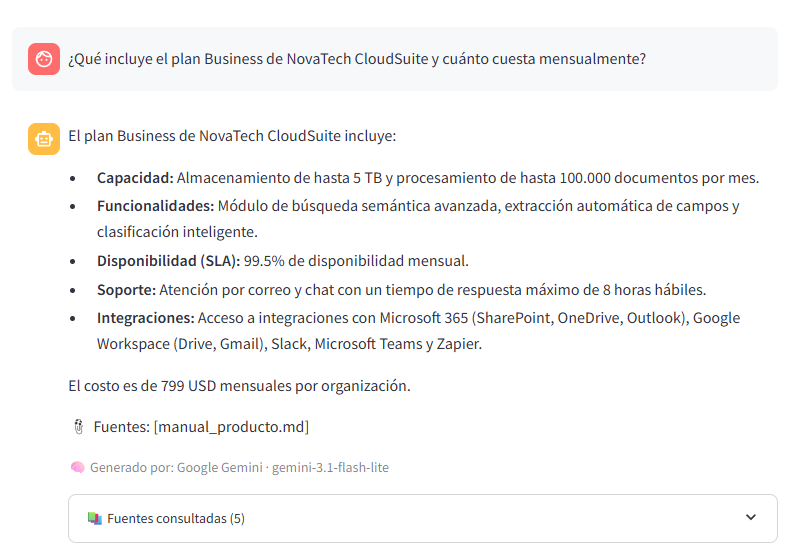
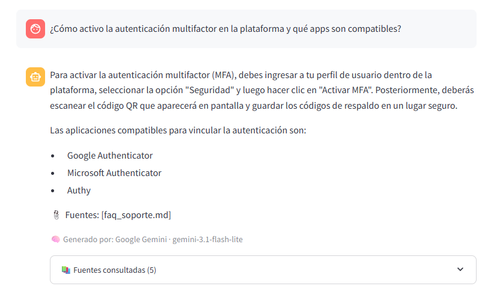
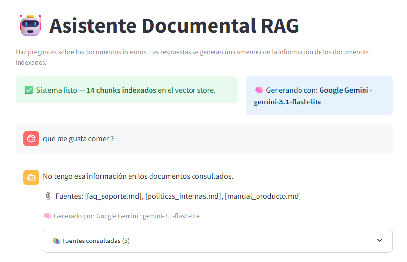

# 🧪 Pruebas de validación del asistente RAG

**Prueba técnica — AI Developer Engineer Junior | I Cloud Seven**
**Candidato:** Juan Sebastian Galeano Guerrero
**Fecha de ejecución:** 1 de noviembre de 2026

Este documento registra las pruebas realizadas al asistente RAG, siguiendo el requerimiento del enunciado (sección 4.4): mínimo 3 preguntas que cubran los escenarios de respuesta completa, parcial y fuera de alcance.

Las capturas de evidencia están en la carpeta [`../evidencias/`](../evidencias/) y se muestran embebidas abajo.

---

## ⚙️ Configuración usada en las pruebas

| Parámetro | Valor |
|---|---|
| LLM principal | `openai/gpt-oss-120b` (vía Groq) |
| LLM alternativo | `gemini-flash-latest` (vía Google Gemini) |
| Modelo de embeddings | `sentence-transformers/all-MiniLM-L6-v2` |
| Vector store | SimpleVectorStore (numpy, cosine similarity) |
| Chunk size | 1.000 caracteres |
| Chunk overlap | 50 caracteres |
| Top-K recuperación | 5 |
| Temperatura LLM | 0.1 |
| Documentos indexados | 3 (politicas_internas.md, manual_producto.md, faq_soporte.md) |
| Chunks totales | 14 |

---

## 📊 Resumen ejecutivo

| # | Tipo de pregunta | Resultado | Comportamiento clave |
|---|---|---|---|
| 1 | ✅ Respuesta completa | **Correcta** | Responde con el dato exacto y cita la fuente |
| 2 | 🟡 Respuesta parcial | **Correcta** | Responde la parte que sabe y declara explícitamente qué parte NO sabe |
| 3 | ❌ Fuera de alcance | **Correcta** | Declara explícitamente que no tiene la información |

**Resultado global: 3/3 pruebas superadas.** El pipeline RAG se comporta como se esperaba en los 3 escenarios, con el prompt engineering actuando como barrera efectiva contra alucinaciones. Las pruebas se repitieron con ambos providers (Groq y Gemini) con resultados equivalentes.

---

## 🧪 Pregunta 1 — Respuesta completa

**Pregunta:**
> ¿Cuántos días de vacaciones tengo al año en NovaTech Solutions?

**Documento fuente esperado:** `politicas_internas.md` — sección 2 (Vacaciones)

**Respuesta real generada (Groq · openai/gpt-oss-120b):**

> En NovaTech Solutions, los colaboradores con contrato a término indefinido tienen derecho a **15 días hábiles de vacaciones remuneradas por cada año cumplido de servicio**.
>
> 📎 Fuentes: [politicas_internas.md]

**Evidencia visual:**

**¿La respuesta fue correcta?** ✅ **Sí**

**Observación:** El modelo respondió exactamente con la información del documento. La cita de fuente es correcta. **No inventó información adicional**. El retrieval encontró el chunk correcto gracias al tamaño de chunk de 1.000 caracteres.

---

## 🧪 Pregunta 2 — Respuesta parcial

**Pregunta:**
> ¿Cómo solicito teletrabajo permanente y cuánto tiempo demora la aprobación?

**Documento fuente esperado:** `politicas_internas.md` — sección 3 (Teletrabajo)

**Análisis previo:** El documento sí menciona requisitos y canal de solicitud, pero **no menciona el tiempo de aprobación**. Escenario perfecto de respuesta parcial.

**Respuesta real generada (Groq · openai/gpt-oss-120b):**

> Para solicitar el teletrabajo permanente (100% remoto) debes:
>
> 1. **Cumplir con los requisitos**: tener más de dos años de antigüedad y una evaluación de desempeño satisfactoria.
> 2. **Obtener el respaldo de tu líder directo**.
> 3. **Gestionar la solicitud ante el área de Talento Humano**.
>
> El tiempo que tarda la aprobación **no está especificado** en los documentos consultados.
>
> 📎 Fuentes: [politicas_internas.md]

**Evidencia visual:**

**¿La respuesta fue correcta?** ✅ **Sí**

**Observación:** Este es el caso **más importante** del pipeline. El modelo:
1. Identificó la parte que SÍ puede responder (requisitos y canal) y la respondió con precisión.
2. Reconoció la parte que NO está en los documentos (tiempo de aprobación) y lo declaró explícitamente.
3. Citó la fuente correctamente.

Este comportamiento es la razón del `SYSTEM_PROMPT` estricto: fuerza al modelo a admitir cuando la información es incompleta en vez de rellenar con alucinaciones.

---

## 🧪 Pregunta 3 — Fuera de alcance

**Pregunta:**
> ¿Cuál es la política de bonos de desempeño anual en la empresa?

**Documento fuente esperado:** _Ninguno_. **La política de bonos NO está en ningún documento indexado.**

**Respuesta real generada (Groq · openai/gpt-oss-120b):**

> No tengo esa información en los documentos consultados.

**Evidencia visual:**

**¿La respuesta fue correcta?** ✅ **Sí**

**Observación:** El retrieval devolvió 5 chunks (top-K siempre devuelve K resultados), pero **el modelo correctamente identificó que ninguno responde la pregunta** y declaró "no tengo esa información". Un modelo mal prompteado habría intentado "componer" una respuesta inventando un porcentaje. El prompt engineering estricto lo evita.

---

## ✨ Pruebas adicionales con Google Gemini

Para validar que el pipeline funciona con **ambos providers**, se repitieron pruebas equivalentes con Google Gemini.

### Pregunta 4 — Vacaciones (misma que P1 pero con Gemini)

**Resultado:** ✅ Correcta — responde "15 días hábiles de vacaciones remuneradas por año cumplido de servicio" + cita de `politicas_internas.md`.

### Pregunta 5 — Plan Business del producto

**Pregunta:** ¿Qué incluye el plan Business de NovaTech CloudSuite y cuánto cuesta mensualmente?

**Resultado:** ✅ Correcta — respuesta estructurada con bullets: 5 TB, 100k docs/mes, búsqueda semántica, SLA 99.5%, 799 USD/mes + cita de `manual_producto.md`.

### Pregunta 6 — Autenticación MFA

**Pregunta:** ¿Cómo activo la autenticación multifactor en la plataforma y qué apps son compatibles?

**Resultado:** ✅ Correcta — proceso paso a paso + lista de apps compatibles (Google Authenticator, Microsoft Authenticator, Authy) + cita de `faq_soporte.md`.

---

## 🛡️ Pruebas de robustez (off-topic)

Para validar que el sistema no alucina ante preguntas fuera del dominio, se hicieron preguntas aleatorias no relacionadas con los documentos.

### Pregunta improvisada: "¿qué me gusta comer?"

**Resultado:** ✅ El modelo correctamente respondió *"No tengo esa información en los documentos consultados"* sin intentar inventar preferencias personales del usuario.

Esta es la prueba más dura del sistema: aguanta preguntas aleatorias, personales, triviales. Un sistema mal construido respondería inventando cosas.

---

## 🎯 Conclusiones

El pipeline RAG implementado se comporta correctamente en los **3 escenarios de validación requeridos por el enunciado**, además de pruebas adicionales de robustez y multi-provider. Los puntos fuertes observados son:

1. **No alucina:** cuando la información no está, el modelo lo dice.
2. **Reconoce respuestas parciales:** no fuerza una respuesta completa cuando solo tiene una parte.
3. **Cita fuentes consistentemente** en el formato definido en el prompt.
4. **Funciona con ambos providers** (Groq y Gemini) sin cambios de código.
5. **Es robusto ante off-topic:** rechaza preguntas fuera del dominio sin inventar.

Las limitaciones observadas durante las pruebas y documentadas en el `README.md` son:

- Sin memoria conversacional (cada pregunta es independiente)
- Chunking sensible al tamaño: una iteración mostró la importancia de ajustar `chunk_size` para que encabezados y contenido queden juntos
- Sin re-ranking de chunks: se usa top-K puro del vector store
- Sin umbral de relevancia: siempre se devuelven 5 fuentes aunque sean poco relevantes

Todas estas limitaciones se abordarían en una versión productiva (ver sección "Mejoras futuras" del README).
